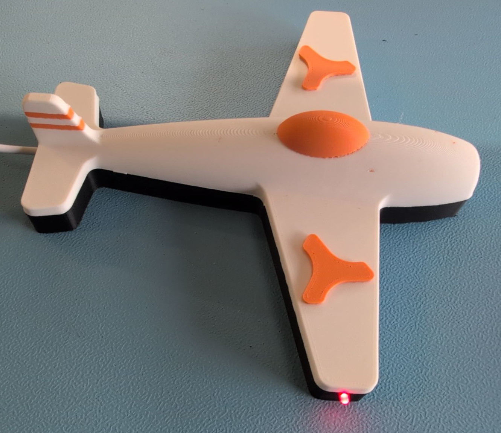
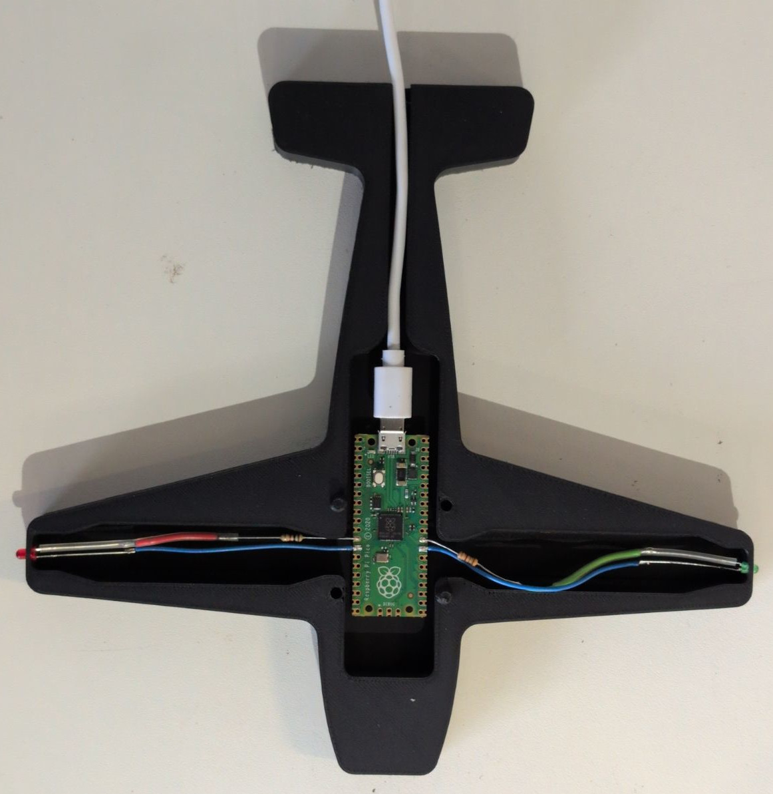

# kidsday
Ein kleines Lötprojekt für Kids. Blinkende LEDs an einem Flugzeug.

# Ziele
- Löten lernen
- Leuchtdioden ansteuern mit Vorwiderstand
- Raspberry Pi Pico kennen lernen

# Bauanleitung

# BOM
- Raspberry Pi Pico. (Teilenummer: SC0915)
- Leuchtdioden: 1 * rote LED, 1 * grüne LED (Durchmesser: 3mm)
- Widerstände: 1000 ohm, 200 ohm
- Schrumpfschlauch 3cm
- 3D-Drucke: Boden
- 3D-Druck: Deckel ( Danke an wleigh als basis )

# Arduino
1) Installation von Arduino
https://www.arduino.cc/en/software/

2) Hinzufügen von Raspberry pi pico library

3) Boards Manager -> Raspberry Pi Pico/RP3040/RP2350 by "Earle F. Philhower, III"

4) Board "Raspberry Pi Pico" wählen

5) Datei *.ino in arduino öffnen, compilieren und flashen

# LED Vorwiderstände berechnen
## Rote LED
- Spannung vom digitalen Ausgang: 3.3V
- Spannung benötigt fürs rote LED: 2V
- Spannung am Vorwiderstand der roten LED: 3.3V-2V = 1.3V
- Benötigter Strom für vernünftige Helligkeit: ~1.3mA
- Vorwiderstand rote LED: R = U / I = 1.3V / 1.3mA = 1000 ohm

## Grüne LED
- Spannung vom digitalen Ausgang: 3.3V
- Spannung benötigt fürs grüne LED: 2.5V
- Spannung am Vorwiderstand der grünen LED: 3.3V-2.5V = 0.8V
- Benötigter Strom für vernünftige Helligkeit: ~4mA
- Vorwiderstand grüne LED: R = U / I = 0.8V / 4mA = 200 ohm

# Easteregg
Die grüne LED wäre eigentlich rechts. Dies gilt für Schiffe und Flugzeuge.
